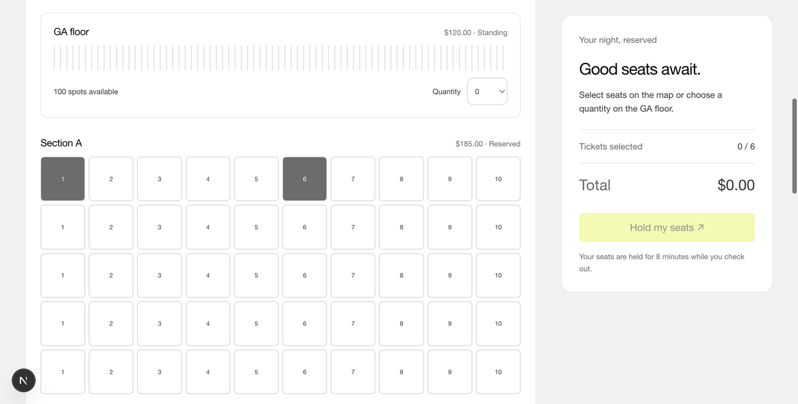

<div align="center">

# TicketSenpai

**A local concert-ticketing app with reserved seating, timed holds, and race-safe checkout.**

Built with Next.js, Flask, and SQLite as a web-application security capstone.

[](https://nodejs.org/)
[](https://www.python.org/)
[](https://nextjs.org/)
[](https://flask.palletsprojects.com/)
[](https://www.sqlite.org/)
[](CONTRIBUTING.md)

[Quick start](#quick-start) ·
[Features](#features) ·
[Documentation](#documentation) ·
[API](docs/api.md) ·
[Contributing](CONTRIBUTING.md) ·
[Security](SECURITY.md)



</div>

> [!WARNING]
> TicketSenpai is a **local learning project**, not production software. Both
> servers bind to `127.0.0.1`, payment is simulated, and every show is fictional.
> Use synthetic data only.

## Table of contents

- [About](#about)
- [Features](#features)
- [Quick start](#quick-start)
- [Demo accounts](#demo-accounts)
- [Usage](#usage)
- [How it works](#how-it-works)
- [Commands](#commands)
- [Project structure](#project-structure)
- [API overview](#api-overview)
- [Testing](#testing)
- [Security](#security)
- [Documentation](#documentation)
- [Submission package](#submission-package)
- [Reference mock and deferred scope](#reference-mock-and-deferred-scope)
- [Contributing](#contributing)
- [Acknowledgements](#acknowledgements)

## About

TicketSenpai lets you browse fictional concerts, pick seats on a live venue map,
hold them for eight minutes, and check out with a simulated payment. It focuses
on getting the hard parts of ticketing right on a small scale:

- **No double-selling.** Competing holds and checkouts are serialized by SQLite
  transactions, and a unique constraint guarantees a seat can only be in one
  confirmed order.
- **Safe retries.** Hold and checkout requests are idempotent, so a double click
  or a network retry never buys twice.
- **Fair limits.** Six seats per person per event, counting both held and purchased seats.

It repurposes the seat map, timed holds, purchase rules, and Ramp visual tokens
from the original in-memory [reference mock](#reference-mock-and-deferred-scope).

### Milestone 3 remediation

The project was built as a security capstone. Milestone 1 shipped six intentional
vulnerabilities (V01–V06) for peer testing. **All six are fixed** in Milestone 3:

| ID | Weakness | Fix |
| --- | --- | --- |
| V01 | SQL injection | Search uses a parameterized query |
| V02 | Stored XSS | Reviews render as escaped React text |
| V03 | IDOR | Order lookups are scoped to the signed-in user (404 otherwise) |
| V04 | Predictable sessions | Random `secrets.token_urlsafe(32)` tokens, rotated on login |
| V05 | Plaintext passwords | Salted scrypt hashes via werkzeug |
| V06 | Traceback disclosure | `DEBUG=False`, generic 500 body, details logged server-side |

See the [remediation record](docs/vulnerabilities.md) for the code changes and
how to verify each fix.

> [!IMPORTANT]
> **Upgrading from a Milestone 1 build?** Its database still holds plaintext
> passwords, so demo logins fail with "Email or password is incorrect." Stop the
> servers and run `make reset CONFIRM=reset`. Fresh installs are unaffected.

## Features

| Area | What you can do |
| --- | --- |
| **Discovery** | Browse and search shows. Three published shows plus one unpublished draft that search never returns. |
| **Accounts** | Register, sign in and out, and edit your profile name. |
| **Seat selection** | Pick reserved seats or a general-admission quantity. Each event has 50 premium, 120 standard, and 100 GA seats, preserving the original venue layout. |
| **Holds** | Reserve up to six seats per person per event for eight minutes. Reloading the event page restores your active hold. |
| **Checkout** | Simulate an approved or declined payment. A decline keeps the hold for another attempt. Successful purchases issue local ticket identifiers. |
| **Tickets** | See purchases in My Tickets and on individual order pages. |
| **Reviews** | Post reviews on events. |
| **Administration** | Administrators create and edit events and publish or unpublish them. |
| **Accessibility** | Light and dark themes, keyboard seat navigation, and responsive layouts. |

## Quick start

### Prerequisites

- **Node.js 22+** (with npm)
- **Python 3.10+** (on Linux, `venv` support may be a separate OS package)
- **make**
- macOS, Linux, or Windows via WSL

Internet access is needed to install dependencies, not to run the app.

### Install and run

Clone the repository (requires Git), or download and extract its source ZIP:

```sh
git clone https://github.com/Kandel-Bibas/TicketSenpai.git
cd TicketSenpai
make setup
make dev
```

Open **<http://127.0.0.1:3000>**. Press Ctrl+C to stop both servers.

`make setup` installs pinned JavaScript dependencies from the lockfile, creates
`backend/.venv`, installs Flask, and initializes the database. It preserves
existing data when rerun. Stop the servers before running setup again.

> [!TIP]
> If your Python 3.10+ has a different command name, run
> `make setup PYTHON=python3.12`. Something not working? See
> [troubleshooting](docs/troubleshooting.md).

The frontend proxies `/api/*` to Flask on `127.0.0.1:5001`. Use the frontend URL
for both the browser and API demonstrations so session cookies stay on one
origin. The dev script rejects occupied ports rather than silently selecting
another port.

## Demo accounts

| Account | Email | Password |
| --- | --- | --- |
| Customer Alice | `alice@example.test` | `alice-demo` |
| Customer Bob | `bob@example.test` | `bob-demo` |
| Administrator | `admin@example.test` | `admin-demo` |

New users can register at `/register`. Only seeded administrators can manage
events. Every seeded show is fictional; payment is simulated and never uses a card.

## Usage

1. Open <http://127.0.0.1:3000> and sign in as Alice.
2. Choose a show under **Explore**.
3. Select up to six seats on the map, or a general-admission quantity, and hold them.
4. Choose an approved or declined payment and check out.
5. Find your tickets under **My tickets**.

The [user guide](docs/user-guide.md) covers every step in detail.

Sign in as the administrator to create, edit, publish, and unpublish events
under **Manage events**. See the [administrator guide](docs/admin-guide.md).

Prefer the command line? The [API reference](docs/api.md#end-to-end-example)
walks through the same purchase with `curl`.

## How it works

```text
Browser ──► Next.js (127.0.0.1:3000) ──/api/*──► Flask (127.0.0.1:5001) ──► SQLite (WAL)
```

- **Concurrency.** SQLite transactions serialize competing hold and checkout
  writes. Unique order-item constraints prevent a seat from appearing in two
  confirmed orders.
- **Idempotency.** Successful hold and checkout requests replay by
  `Idempotency-Key`; a reused key with a changed body returns 409. A declined
  checkout also replays, so retry payment with a new key. Failures roll back and
  are not saved in the idempotency table. Repeated review or admin-create
  submissions create separate records; edit operations overwrite values.
- **Expiry.** Expired holds are released lazily on inventory reads or purchase
  operations. A hold cannot be bought after expiry even if no browser has polled.
- **Persistence.** Purchases and sessions persist across restarts. Sessions
  expire after 24 hours.
- **Pricing.** Prices are calculated on the server and cannot change while seats
  for an event are held or sold.
- **Publishing.** Unpublishing an event prevents new checkout, including checkout
  of an existing hold.

The [architecture guide](docs/architecture.md) covers the data model, hold state
machine, and design decisions in depth.

## Commands

| Command | Result |
| --- | --- |
| `make setup` | Install dependencies and initialize data |
| `make dev` | Run Next.js and Flask together |
| `make test` | Run the reference Node suite and the Flask HTTP tests |
| `make build` | Build the Next.js frontend |
| `make check` | Run both test suites and the frontend build |
| `make package` | Build and verify `output/Sentinel_Milestone3.zip` from source and `Defense_Report.pdf` |
| `make smoke` | Fresh install in a temporary directory, repeat setup, start/stop/restart both servers, and verify reset safeguards (ports 3000 and 5001 must be free) |
| `make reset CONFIRM=reset` | Delete and reseed only TicketSenpai's local database; servers must be stopped |

No linter is installed. The frontend uses JavaScript; the build is not a
TypeScript validation claim.

## Project structure

```text
TicketSenpai/
├── frontend/            Next.js App Router UI
│   ├── app/             Pages and styles
│   ├── components/      Shared UI and the seat map
│   └── lib/api.js       API client and formatting helpers
├── backend/             Flask API
│   ├── run.py           Dev entry point (127.0.0.1:5001)
│   ├── ticketsenpai/
│   │   ├── __init__.py  HTTP validation, session handling, API routes
│   │   ├── service.py   Hold, expiry, ownership, and checkout rules
│   │   ├── db.py        SQLite connection, seed data
│   │   └── schema.sql   Database schema
│   ├── tests/           Flask HTTP tests
│   └── instance/        Generated, git-ignored local database
├── scripts/             Setup, dev supervisor, reset, packaging, verification
├── docs/                Documentation
├── src/ web/ test/      Original in-memory Node reference mock
└── Makefile             Every common task
```

## API overview

API responses are JSON. Expected errors use `{ "error": { "code", "message" } }`.
Unexpected exceptions return HTTP 500 with code `internal_error` and a generic
message; details go to the server log only. List endpoints use `?page=1` and a
page size of 20. Hold and checkout writes require an `Idempotency-Key` header.

| Method | Path | Purpose |
| --- | --- | --- |
| GET | `/api/health` | Readiness |
| POST | `/api/register`, `/api/login`, `/api/logout` | Account/session lifecycle |
| GET, PATCH | `/api/me` | Read/update profile |
| GET | `/api/events?q=...`, `/api/events/<id>` | Search, or event plus seat map |
| GET, POST | `/api/events/<id>/reviews` | Read/write reviews |
| POST | `/api/events/<id>/holds` | Reserve `seat_ids` |
| GET | `/api/events/<id>/hold` | Restore own active hold |
| DELETE | `/api/holds/<id>` | Release own hold |
| GET, POST | `/api/orders` | Own order list, or checkout using `hold_id` and `payment` |
| GET | `/api/orders/<id>` | Own order details (404 for another user's order) |
| GET, POST | `/api/admin/events` | List all events or create one |
| PUT | `/api/admin/events/<id>` | Edit event |

Full request and response details, validation rules, and every error code are in
the [HTTP API reference](docs/api.md).

## Testing

```sh
make test    # reference Node suite + Flask HTTP tests
make check   # both suites + frontend production build
```

Backend tests use Python's standard-library `unittest` runner against temporary
databases:

```sh
cd backend
.venv/bin/python -m unittest discover -s tests -v
.venv/bin/python -m unittest discover -s tests -k concurrent -v
```

They cover concurrent holds and checkouts, expiry, idempotency, ownership,
limits, admin rules, and `test_v01_*` through `test_v06_*` regression tests for
every remediated vulnerability. See the [development guide](docs/development.md#testing).

## Security

> [!CAUTION]
> Login throttling and lockout are not implemented, so repeated password guessing
> is not rate limited. Treat this as a known limitation. A second review of the
> authentication and session code is recommended before any use beyond local
> coursework.

Please **do not** report vulnerabilities in public issues. See
[SECURITY.md](SECURITY.md) for how to report privately, the security model, and
all known limitations.

## Documentation

| Guide | Description |
| --- | --- |
| [Documentation index](docs/README.md) | Every document in one place |
| [User guide](docs/user-guide.md) | Finding shows, holding seats, and buying tickets |
| [Administrator guide](docs/admin-guide.md) | Managing, publishing, and pricing events |
| [Architecture](docs/architecture.md) | Processes, request flow, data model, holds, checkout |
| [HTTP API reference](docs/api.md) | Endpoints, payloads, and error codes |
| [Database reference](docs/database.md) | Tables, columns, indexes, and seed data |
| [Frontend guide](docs/frontend.md) | Routes, components, and the API client |
| [Configuration reference](docs/configuration.md) | Every port, limit, and timing constant |
| [Development guide](docs/development.md) | Setup, running, and conventions |
| [Testing guide](docs/testing.md) | What each test proves and how to write new ones |
| [Troubleshooting and FAQ](docs/troubleshooting.md) | Common errors and fixes |
| [Threat model](docs/threat-model.md) | STRIDE analysis and accepted risks |
| [Remediation record](docs/vulnerabilities.md) | V01–V06 fixes and how to verify them |
| [Glossary](docs/glossary.md) | Project terms |
| [Changelog](CHANGELOG.md) | Changes by milestone |

## Submission package

`make package` builds and verifies `output/Sentinel_Milestone3.zip` (project
folder `Sentinel_Milestone3/`). It contains the application and reference
source, tests, screenshots, this README, the docs, and `Defense_Report.pdf` at
the folder root. The packager checks archived bytes and CRCs and writes a
companion SHA-256 file. It excludes installed dependencies, build output, local
databases, and session data.

With ports 3000 and 5001 free, `python3 scripts/verify_submission.py` extracts
the ZIP into a temporary directory and runs setup, both suites and the build,
startup/shutdown smoke checks, and repackaging. This requires internet access for
the fresh install.

The defense report source is `docs/defense-report.html`. To rebuild
`Defense_Report.pdf`, run `python3 scripts/build_defense_report.py` (requires
Google Chrome). This optional tool is not needed for `make setup`, `make dev`, or
packaging. [PROJECT_SUMMARY.pdf](PROJECT_SUMMARY.pdf) stays in the repository as
the Milestone 1 record and is no longer packaged. The
[generic team plan](docs/team-plan.md) and
[course-material alignment checklist](docs/course-alignment.md) are Milestone 1
records. Screenshots live in `docs/screenshots/`; recapture them after meaningful
interface changes.

## Reference mock and deferred scope

The original `src/`, `web/`, and `test/` remain runnable with `npm start`,
`npm run web`, and `npm test`. They are a separate Node/in-memory application;
TicketSenpai does not call them. Its ported behavior is covered by the Flask
tests. See [the reference backend guide](docs/reference-backend.md) and
[ticketing-platform-design.html](ticketing-platform-design.html).

The waiting-room controller, crowd simulation, PSP outage recovery, and
background payment pipeline are deferred from this capstone scope. The course
starter was reviewed on October 15, 2026 and matches the application's overall
stack and layout; port, proxy, package structure, and version differences are
documented in the [alignment checklist](docs/course-alignment.md).

## Contributing

Contributions are welcome! Please read [CONTRIBUTING.md](CONTRIBUTING.md) for
the workflow and pull request checklist, and follow our
[Code of Conduct](CODE_OF_CONDUCT.md). For questions, see [SUPPORT.md](SUPPORT.md).

```sh
make setup && make check   # make sure everything passes before you start
```

## Acknowledgements

- Built as a capstone for a web-application security course.
- Seat geometry, hold rules, and visual design are ported from the project's own
  in-memory reference mock.
- Vulnerability categories follow the [OWASP Top 10 (2021)](https://owasp.org/Top10/).
- Code of Conduct adapted from the [Contributor Covenant](https://www.contributor-covenant.org/).
