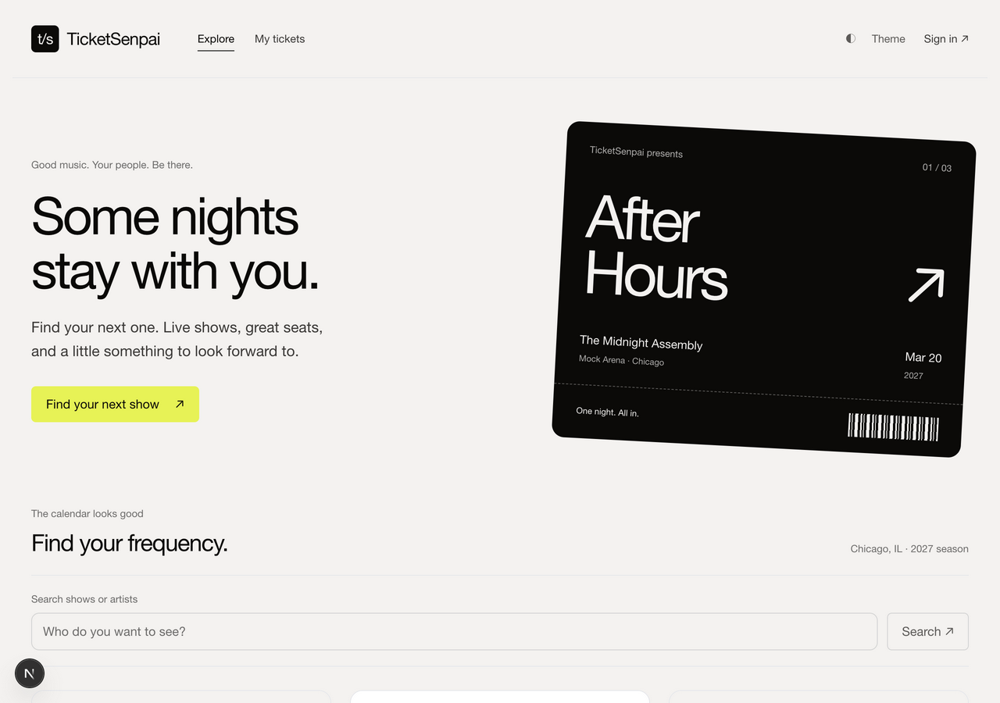
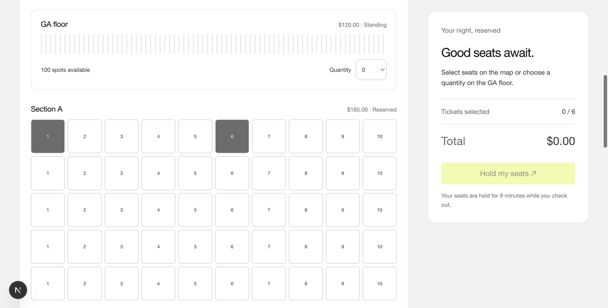
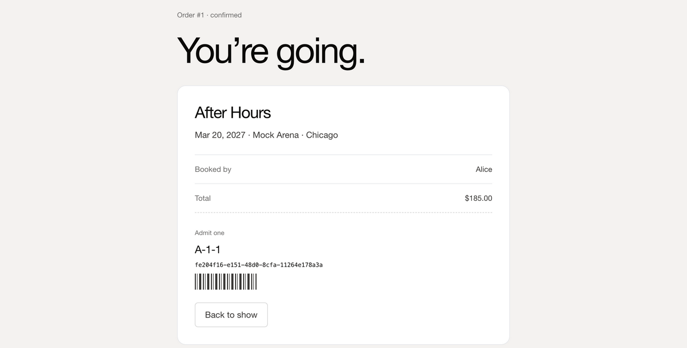
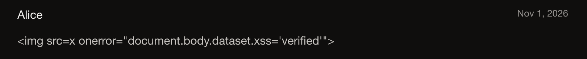

# TicketSenpai documentation

Start with the [project README](../README.md) for an overview and quick start.

## Guides

| Document | Read it when you want to… |
| --- | --- |
| [Architecture](architecture.md) | Understand the processes, request flow, data model, holds, checkout, and design decisions |
| [HTTP API reference](api.md) | Call the API directly or change an endpoint |
| [Development guide](development.md) | Set up, run, test, and change the code |
| [Troubleshooting and FAQ](troubleshooting.md) | Fix an error or find a quick answer |

## Security

| Document | Contents |
| --- | --- |
| [Security policy](../SECURITY.md) | How to report a vulnerability, security model, known limitations |
| [Remediation record](vulnerabilities.md) | The six Milestone 1 weaknesses (V01–V06), their fixes, and how to verify each |

## Project

| Document | Contents |
| --- | --- |
| [Contributing](../CONTRIBUTING.md) | Workflow, commit style, and pull request checklist |
| [Code of Conduct](../CODE_OF_CONDUCT.md) | Community standards |
| [Support](../SUPPORT.md) | Where to ask for help |
| [Changelog](../CHANGELOG.md) | What changed in each milestone |

## Reference mock

| Document | Contents |
| --- | --- |
| [Reference backend guide](reference-backend.md) | The original in-memory Node.js mock in `src/`, `web/`, and `test/` |
| [`ticketing-platform-design.html`](../ticketing-platform-design.html) | The large-scale ticketing design the mock implements |
| [`waiting-room-explainer.html`](../waiting-room-explainer.html) | Explainer for the waiting-room design |

## Course records

These are historical records of the capstone submission. They describe the state
of the project at the time they were written and are not updated.

| Document | Milestone |
| --- | --- |
| [Defense report source](defense-report.html) and [`Defense_Report.pdf`](../Defense_Report.pdf) | Milestone 3 |
| [Submission verification](verification.md) | Milestone 1 |
| [Team plan](team-plan.md) | Milestone 1 |
| [Course-material alignment](course-alignment.md) | Milestone 1 |
| [`PROJECT_SUMMARY.pdf`](../PROJECT_SUMMARY.pdf) | Milestone 1 |

## Screenshots

Interface screenshots live in [`screenshots/`](screenshots/). Recapture them after
meaningful interface changes.

| | |
| --- | --- |
|  |  |
| Event discovery | Seat map |
|  |  |
| Confirmed ticket | A review containing HTML, rendered as text (V02 fix) |

## Writing documentation

- Write for someone who has just cloned the repository.
- Use the exact error messages and codes the app produces, so people can search for them.
- Prefer tables for reference material and numbered steps for procedures.
- Link to source files with relative paths so links work on GitHub and in the
  submission ZIP.
- Update docs in the same pull request as the behavior they describe.
