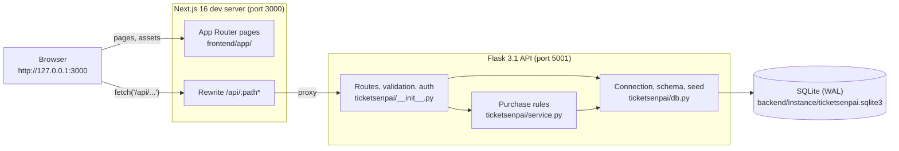
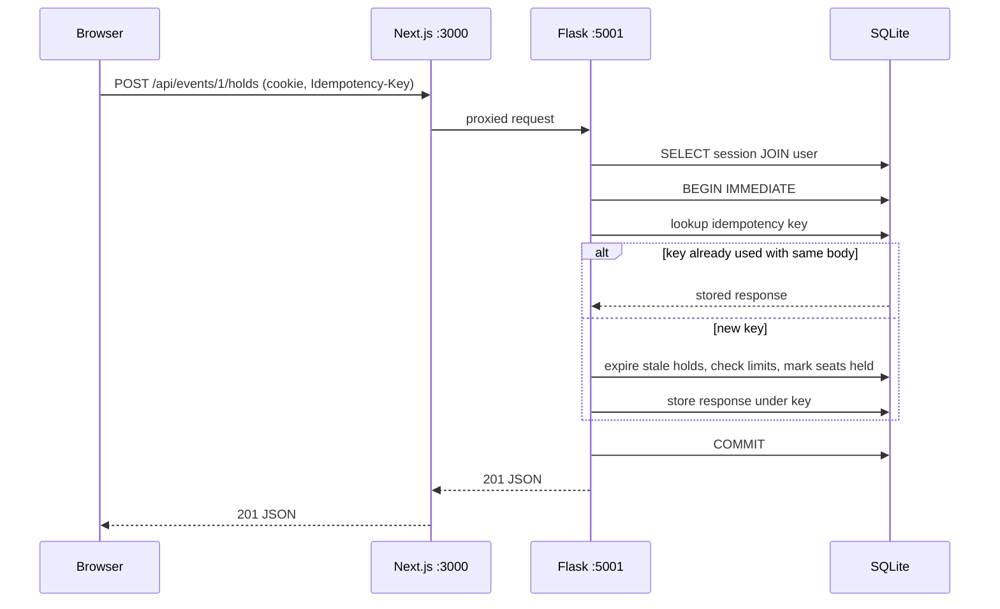
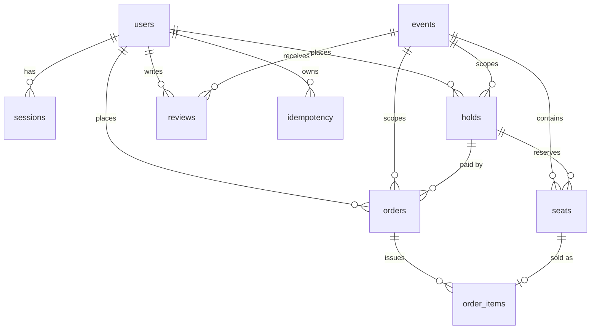
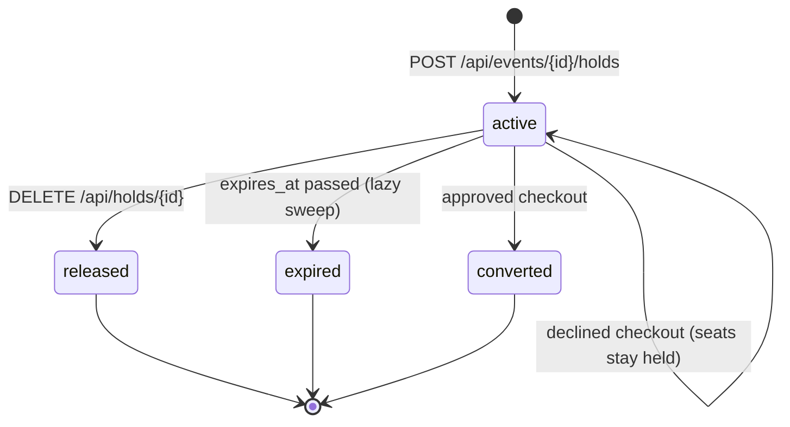

# Architecture

This guide explains how TicketSenpai is put together: the processes that run, how
a request travels through them, how data is stored, and the rules that keep seat
inventory correct under contention. It describes the code as it is today. If you
change behavior, update this page in the same pull request.

- [System overview](#system-overview)
- [Repository layout](#repository-layout)
- [Request lifecycle](#request-lifecycle)
- [Data model](#data-model)
- [Seat inventory and holds](#seat-inventory-and-holds)
- [Checkout](#checkout)
- [Idempotency](#idempotency)
- [Authentication and sessions](#authentication-and-sessions)
- [Error handling](#error-handling)
- [Frontend](#frontend)
- [The reference mock (`src/`, `web/`, `test/`)](#the-reference-mock-src-web-test)
- [Design decisions](#design-decisions)

## System overview

TicketSenpai is two local processes and one SQLite file.



| Process | Started by | Binds to | Responsibility |
| --- | --- | --- | --- |
| Next.js | `npm run dev` in `frontend/` | `127.0.0.1:3000` | Renders the UI and proxies `/api/*` to Flask |
| Flask | `python run.py` in `backend/` | `127.0.0.1:5001` | JSON API, validation, sessions, purchase rules |

`make dev` runs [`scripts/dev.py`](../scripts/dev.py), which checks that both
ports are free, starts both servers in their own process groups, and stops both
when you press Ctrl+C or when either one exits.

The browser only ever talks to port 3000. The rewrite in
[`frontend/next.config.mjs`](../frontend/next.config.mjs) forwards `/api/*` to
Flask, so the session cookie is set and sent on a single origin and no CORS
configuration is needed.

## Repository layout

```text
TicketSenpai/
├── backend/                  Flask API
│   ├── run.py                Dev entry point (127.0.0.1:5001, debug off)
│   ├── requirements.txt      Pinned Python dependencies
│   ├── ticketsenpai/
│   │   ├── __init__.py       create_app(): routes, validation, auth, error handlers
│   │   ├── service.py        Holds, expiry, idempotent replay, checkout, order reads
│   │   ├── db.py             Connection settings, transactions, schema init, seed data
│   │   └── schema.sql        Tables and indexes
│   ├── tests/test_app.py     unittest HTTP tests (purchase rules + V01–V06 regressions)
│   └── instance/             Generated SQLite database (git-ignored)
├── frontend/                 Next.js App Router UI (JavaScript)
│   ├── app/                  Routes: /events, /events/[id], /tickets, /tickets/[id],
│   │                         /login, /register, /profile, /admin
│   ├── components/           shell.js (session + layout), seat-map.js, auth-form.js
│   ├── lib/api.js            fetch wrapper, money and date formatting
│   └── next.config.mjs       /api rewrite to Flask
├── scripts/                  setup, dev supervisor, reset, packaging, verification
├── docs/                     Project documentation (you are here)
├── src/  web/  test/         Original in-memory Node reference mock (independent)
├── Makefile                  Entry point for every common task
└── package.json              Scripts for the reference mock (npm start / test / web)
```

## Request lifecycle

Every API request follows the same path through Flask:

1. **`before_request`** opens a fresh SQLite connection and stores it on `flask.g`.
2. **Route decorator `auth()`** (only on protected routes) reads the `session`
   cookie, joins `sessions` to `users`, rejects missing or expired sessions with
   `401 unauthenticated`, and rejects non-admins on admin routes with `403 forbidden`.
3. **Input helpers** (`body()`, `text()`, `email()`, `page()`) validate the request
   and raise `Problem` with a stable error code on bad input.
4. **Business logic** runs, usually inside `transaction()`, which issues
   `BEGIN IMMEDIATE` so concurrent writers queue on SQLite's write lock.
5. **Error handlers** turn `Problem`, Werkzeug `HTTPException`, and any other
   exception into the JSON error envelope.
6. **`teardown_request`** closes the connection.



## Data model

The schema lives in [`backend/ticketsenpai/schema.sql`](../backend/ticketsenpai/schema.sql)
and is applied with `CREATE TABLE IF NOT EXISTS` on every app start, so it is
safe to rerun. Foreign keys are enforced (`PRAGMA foreign_keys = ON`) and the
database uses write-ahead logging.



| Table | Key | Notes |
| --- | --- | --- |
| `users` | `id` | `email` is unique; `password` is a werkzeug scrypt hash; `role` is `customer` or `admin` |
| `sessions` | `token` | Random 43-character token, `expires_at` as a Unix timestamp |
| `events` | `id` | `price_cents` is the base price; `published` is `0` or `1` |
| `seats` | `(event_id, id)` | `status` is `available`, `held`, or `sold`; `hold_id` links a held seat to its hold |
| `holds` | `id` (UUID) | `status` is `active`, `released`, `expired`, or `converted` |
| `orders` | `id` | `status` is `confirmed` or `declined`; `total_cents` computed server-side |
| `order_items` | `(event_id, seat_id)` | One row per sold seat; the primary key makes double-selling impossible; `barcode` is a unique UUID |
| `reviews` | `id` | Body is stored verbatim and escaped on output |
| `idempotency` | `(user_id, scope, key)` | Request fingerprint and the stored JSON response |

### Seat geometry and pricing

Every event gets the same 270-seat venue, created by `add_seats()` in
[`db.py`](../backend/ticketsenpai/db.py). The geometry is carried over from the
reference mock's `src/seed.js`.

| Section | Layout | Seat IDs | Price |
| --- | --- | --- | --- |
| `A` (premium) | 5 rows × 10 seats = 50 | `A-<row>-<seat>` | base + $90.00 |
| `B` (standard) | 10 rows × 12 seats = 120 | `B-<row>-<seat>` | base |
| `GA` (general admission) | 100 spots | `GA-<n>` | base + $25.00 |

### Seed data

On first start, when the `users` table is empty, `initialize()` creates three
accounts, four events (three published, one unpublished draft named
**Unannounced show**), and one review. It never reseeds a database that already
has users. To start over, stop the servers and run `make reset CONFIRM=reset`.

## Seat inventory and holds

A hold reserves 1–6 seats for one user for **8 minutes** (480 seconds).



Rules enforced by `create_hold()` in [`service.py`](../backend/ticketsenpai/service.py):

- The event must exist and be published.
- The request must name 1–6 **distinct** seat IDs.
- Seats already bought plus seats in active holds plus the new request must not
  exceed **six per user per event**.
- Every seat must exist and be `available`. If any seat fails, the whole
  transaction rolls back and no seat is held.

**Lazy expiry.** There is no background job. `expire_holds()` runs at the start
of every operation that reads or changes inventory (event detail, active-hold
lookup, hold creation, checkout, and admin edits). It returns seats from expired
holds to `available` and marks those holds `expired`. Because checkout calls it
first, an expired hold can never be bought, even if no browser polled.

**Concurrency.** Every write runs in `BEGIN IMMEDIATE`, which takes SQLite's
write lock up front. Two shoppers racing for the same seat are serialized: the
first commits, the second sees the seat as `held` and gets `409 seat_taken`.
The `order_items` primary key `(event_id, seat_id)` is a second line of defense
against selling a seat twice.

## Checkout

`checkout()` turns an active hold into an order:

1. Expire stale holds.
2. Load the hold, scoped to the requesting user (`404 hold_not_found` otherwise).
3. Reject holds that are not `active` (`409 hold_expired`).
4. Require the event to still be published, so unpublishing blocks checkout of
   existing holds.
5. Sum `price_cents` of the held seats. Prices come from the database, never
   from the client.
6. Insert an order. If `payment` is `approve`, insert one `order_items` row per
   seat with a random UUID barcode, mark seats `sold`, and mark the hold
   `converted`. If `payment` is `decline`, record a `declined` order and leave
   the hold active so the shopper can try again.

Payment is simulated. No card data is collected, sent, or stored.

## Idempotency

`POST /api/events/<id>/holds` and `POST /api/orders` require an
`Idempotency-Key` header of 8–100 characters. `replay()` in `service.py`:

- Fingerprints the JSON body (sorted keys, compact separators).
- Looks up `(user_id, scope, key)`. The scope is `hold:<event_id>` for holds and
  `checkout` for orders.
- If found with the same fingerprint, returns the stored response unchanged.
- If found with a different fingerprint, returns `409 idempotency_key_reused`.
- Otherwise runs the action and stores its response **in the same transaction**.

Only successful results are stored. If the action raises, the transaction rolls
back and the key stays unused, so the client can retry with the same key. A
declined payment is a successful result (a `declined` order), so it replays too;
retry payment with a new key.

## Authentication and sessions

- Passwords are hashed with `werkzeug.security.generate_password_hash` (scrypt
  with a per-password salt) and verified with `check_password_hash`.
- Login deletes the user's existing sessions and creates a new
  `secrets.token_urlsafe(32)` token, so every login rotates the session.
- The token is sent as the `session` cookie with `HttpOnly`, `SameSite=Strict`,
  and a 24-hour `Max-Age`. The server enforces the same 24-hour expiry.
- Logout deletes the session row and clears the cookie.
- Admin routes require `role = 'admin'`. There is no way to become an admin
  through the API; only seeded administrators exist.

Login throttling and account lockout are **not** implemented. See
[SECURITY.md](../SECURITY.md#known-limitations).

## Error handling

All errors use one envelope:

```json
{ "error": { "code": "seat_taken", "message": "Seat A-1-1 is no longer available. Choose again." } }
```

| Source | How it becomes JSON | Example `code` |
| --- | --- | --- |
| `Problem` (domain errors) | `problem()` handler, with the status set where raised | `seat_limit_exceeded` |
| Werkzeug `HTTPException` | `http_error()`, code derived from the HTTP name | `not_found`, `method_not_allowed` |
| Anything else | `unexpected()`, logs the traceback server-side | `internal_error` (always the same message) |

`code` is the stable contract. `message` is human-readable and may change. The
full list is in the [API reference](api.md#error-codes).

## Frontend

The frontend is a Next.js App Router app written in plain JavaScript. Pages are
client components (or thin wrappers around them) that call the API through `api()` in
[`frontend/lib/api.js`](../frontend/lib/api.js), which:

- Prefixes paths with `/api`.
- Sends JSON bodies with the right `Content-Type`.
- Adds the `Idempotency-Key` header when a `key` option is passed.
- Throws an `Error` carrying the server's `message` and the HTTP `status`.

[`components/shell.js`](../frontend/components/shell.js) loads the current user
from `/api/me`, exposes it through the `useSession()` context, and renders the
header, navigation, and theme toggle (stored in `localStorage` as
`ticketsenpai-theme`). [`components/seat-map.js`](../frontend/components/seat-map.js)
is a React port of the reference mock's seat map with arrow-key navigation and a
six-seat selection cap. Dates are shown in the `America/Chicago` time zone.

## The reference mock (`src/`, `web/`, `test/`)

The repository also contains the original Node.js in-memory mock of a large-scale
ticketing design: waiting room, admission controller, payment pipeline, outbox
relay, and more. It has **no dependencies on, and no connection to,**
TicketSenpai. It is kept as reference material and still runs with `npm start`,
`npm run web`, and `npm test`. See the [reference backend guide](reference-backend.md).

## Design decisions

| Decision | Why |
| --- | --- |
| SQLite with `BEGIN IMMEDIATE` | Zero setup for a local app, and the single writer lock gives simple, correct serialization of seat races |
| Lazy hold expiry | No scheduler to run or keep alive; correctness only depends on checking expiry before every read or write |
| Same-origin proxy instead of CORS | Keeps the session cookie `SameSite=Strict` and first-party |
| Server-side prices | The client can never influence what an order costs |
| Idempotency stored in the write transaction | A retried request can never apply twice, and a failed request never poisons its key |
| Loopback-only binding | This is a local learning project, not a deployment target |
