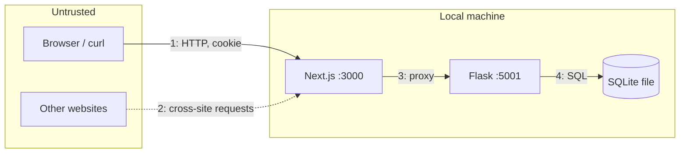

# Threat model

A lightweight threat model of TicketSenpai as it stands after Milestone 3. It
records what we protect, from whom, which controls exist, and which risks are
knowingly accepted. Pair it with the [security policy](../SECURITY.md) and the
[remediation record](vulnerabilities.md).

- [Scope and assumptions](#scope-and-assumptions)
- [Assets](#assets)
- [Actors](#actors)
- [Trust boundaries](#trust-boundaries)
- [Threats and controls (STRIDE)](#threats-and-controls-stride)
- [Accepted risks](#accepted-risks)
- [Keeping this model current](#keeping-this-model-current)

## Scope and assumptions

**In scope:** the Next.js frontend, the Flask API, and the SQLite database, run
with `make dev` on one machine.

**Out of scope:** the reference mock (`src/`, `web/`, `test/`), packaging
scripts, and any deployment beyond loopback.

**Assumptions:**

- Both servers listen only on `127.0.0.1`. Other machines cannot reach them.
- The person running the app controls the machine and its files.
- All data is synthetic. No real personal data or payment data exists.
- Users reach the app through a normal, up-to-date browser at port 3000.

## Assets

| Asset | Why it matters |
| --- | --- |
| User credentials | Taking over an account gives access to its orders and actions |
| Session tokens | Equivalent to credentials for 24 hours |
| Orders and tickets | Contain a buyer's name, seats, and ticket codes |
| Seat inventory | Overselling or blocking seats breaks the core promise |
| Admin capabilities | Can unpublish events, change prices, and create events |
| Reviews | Shown to every visitor, so a delivery path for malicious content |
| Server internals | Stack traces and paths help attackers plan further attacks |

## Actors

| Actor | Capabilities |
| --- | --- |
| Anonymous visitor | Browses, searches, reads reviews, calls public API endpoints |
| Customer | Everything above, plus holds, purchases, reviews, profile |
| Malicious customer | A customer who crafts requests by hand to reach other users' data or game inventory |
| Administrator | Manages events |
| Malicious web page | Another site open in the same browser that tries to send requests to TicketSenpai |
| Local user with file access | Can read the SQLite file directly |

## Trust boundaries

1. **Browser → frontend.** All input is untrusted: bodies, query strings,
   headers, cookies, IDs in URLs.
2. **Other sites → frontend.** Cross-site requests carry no session cookie
   because of `SameSite=Strict`.
3. **Frontend → API.** The proxy passes requests through unchanged. The API
   trusts nothing the frontend checked; it validates everything again.
4. **API → database.** Only bound parameters cross this boundary.

## Threats and controls (STRIDE)

### Spoofing

| Threat | Control | Status |
| --- | --- | --- |
| Guessing or forging a session token | 256-bit random token from `secrets` (V04) | ✅ Mitigated |
| Reusing an old session after re-login | Login deletes the user's other sessions | ✅ Mitigated |
| Online password guessing | None | ⚠️ [Accepted](#accepted-risks) |
| Claiming another identity in a request body | Identity comes only from the session; `role` in bodies is ignored | ✅ Mitigated |

### Tampering

| Threat | Control | Status |
| --- | --- | --- |
| SQL injection through search or IDs | Bound parameters everywhere; integer route converters (V01) | ✅ Mitigated |
| Changing prices from the client | Totals computed from stored seat prices | ✅ Mitigated |
| Repricing after sales start | Price lock (`409 price_locked`) | ✅ Mitigated |
| Selling one seat twice | `BEGIN IMMEDIATE` plus the `order_items` primary key | ✅ Mitigated |
| Exceeding the seat limit with parallel requests | Limit checked inside the serialized write transaction | ✅ Mitigated |
| Double purchase through retries | Idempotency keys stored in the same transaction | ✅ Mitigated |
| Cross-site request forgery | `SameSite=Strict` cookie, JSON-only bodies | ⚠️ Partial, no CSRF token |

### Repudiation

| Threat | Control | Status |
| --- | --- | --- |
| Denying a purchase or review | Orders and reviews record `user_id` and `created_at` | ⚠️ Partial, no audit log of admin edits |

### Information disclosure

| Threat | Control | Status |
| --- | --- | --- |
| Reading another user's order (IDOR) | Queries scoped by `user_id`; foreign orders return the same 404 as missing ones (V03) | ✅ Mitigated |
| Reading another user's hold | Hold lookups scoped by `user_id` | ✅ Mitigated |
| Stack traces in responses | Debug off, generic 500 body, server-side logging (V06) | ✅ Mitigated |
| Password exposure from the database file | Salted scrypt hashes (V05) | ✅ Mitigated |
| Discovering draft events | Every public query filters `published = 1` | ✅ Mitigated |
| Learning whether an email is registered | Login gives the same error for both cases, but registration returns `email_taken` | ⚠️ Accepted |
| Session theft through script | `HttpOnly` cookie; React escapes output | ✅ Mitigated |

### Denial of service

| Threat | Control | Status |
| --- | --- | --- |
| Very large request bodies | 32 KiB limit | ✅ Mitigated |
| Expensive queries through huge pages or IDs | Page capped at 10000; out-of-range IDs rejected early | ✅ Mitigated |
| Hoarding seats with holds | Six-seat limit per user per event, eight-minute expiry | ⚠️ Partial, one person can register many accounts |
| Request flooding | None; loopback-only | ⚠️ Accepted |

### Elevation of privilege

| Threat | Control | Status |
| --- | --- | --- |
| Customer calling admin endpoints | `auth(admin=True)` checks the role on every admin route | ✅ Mitigated |
| Self-registering as admin | `role` is never read from requests | ✅ Mitigated |
| Stored XSS to act as another user | Reviews rendered as text (V02) | ✅ Mitigated |

## Accepted risks

These are accepted because the app is local-only and uses synthetic data. Each
would need a fix before any wider use.

| Risk | Why accepted | What a fix would look like |
| --- | --- | --- |
| No login throttling or lockout | Not reachable from other machines | Per-account and per-IP attempt limits with backoff |
| No CSRF tokens | `SameSite=Strict` and JSON bodies block the practical cross-site attacks in modern browsers | Synchronizer or double-submit tokens |
| No security headers (CSP, frame-ancestors) | Development server only | A strict Content-Security-Policy and `X-Frame-Options: DENY` |
| Account enumeration through registration | Synthetic accounts only | Generic registration response with email confirmation |
| No audit log | Single local operator | Append-only log of admin and account changes |
| Unlimited accounts | No real inventory at stake | Email verification and rate limits |
| Development servers | Not deployed | Production WSGI server and `next start` behind a TLS proxy |

## Keeping this model current

Revisit this page when a pull request:

- Adds an endpoint, a role, or a new kind of user content.
- Changes authentication, sessions, or access checks.
- Changes how the servers bind or how the frontend reaches the API.
- Fixes a security issue.

Add new threats to the matching STRIDE table, and move items between
**Mitigated** and **Accepted** as controls change.
